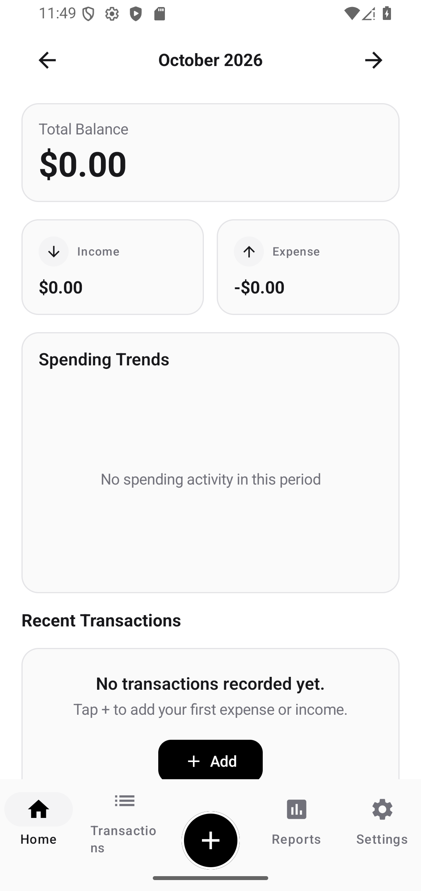

# Expense Tracker — Android Native Application

A production-quality, privacy-first native Android application for personal finance tracking, featuring a minimalist black-and-white fintech interface, modal bottom-sheet transaction entry with custom calculator keypad, offline receipt OCR, authenticated encrypted backups, multi-currency support (USD, KHR), and bilingual localization (English and Khmer).



---

## 1. Architecture & Design Principles

Expense Tracker is architected following modern Android best practices and Clean Architecture principles:

- **UI Layer**: Declarative UI built with **Jetpack Compose** and **Material 3**, strictly styled in a minimalist monochrome palette (pure black `#000000`, white `#FFFFFF`, and subtle neutral grays `#F5F5F5`, `#E5E5E5`, `#737373`). Zero colorful decorations and zero emojis.
- **Presentation Layer**: **MVVM pattern** with `StateFlow` and unidirectional data flow (UDF). Screen state is modeled via immutable data classes.
- **Domain & Utilities**: Exact mathematical calculations using `BigDecimal` and the Shunting-Yard algorithm with Reverse Polish Notation (RPN). Financial operations never use IEEE-754 floating-point types (`Float`/`Double`).
- **Data Layer**: **Room Database** with SQLite, strict foreign key constraints, indexation on date and account fields, and automated database migrations.
- **Dependency Injection**: **Dagger Hilt** for compile-time dependency injection across ViewModels, Repositories, DAOs, and WorkManager.
- **Background Processing**: **AndroidX WorkManager** for recurring transaction scheduling and daily reminder notifications.
- **Security & Cryptography**: **Android Keystore** for local biometric-protected key storage, and **AES-256-GCM** with **PBKDF2** (100,000 iterations, 16-byte salt, 12-byte IV) for passphrase-encrypted backup files (`.etbak`).
- **OCR Engine**: **Google ML Kit Text Recognition** configured for fully offline, on-device parsing of receipt amounts, dates, and merchants.

---

## 2. Technology Stack

| Component | Library / Framework | Version |
| :--- | :--- | :--- |
| **Language** | Kotlin | 2.0.21 |
| **Build System** | Gradle Kotlin DSL | 8.11.1 |
| **Android Gradle Plugin** | AGP | 8.7.2 |
| **Compile / Target SDK** | Android 15 (VanillaIceCream) | API 35 |
| **Minimum SDK** | Android 8.0 (Oreo) | API 26 |
| **UI Toolkit** | Jetpack Compose + Material 3 | Compose BOM 2024.10.00 |
| **Dependency Injection** | Dagger Hilt | 2.51.1 |
| **Local Database** | Room | 2.6.1 |
| **Preferences** | Jetpack DataStore Preferences | 1.1.1 |
| **Concurrency** | Kotlin Coroutines & Flow | 1.9.0 |
| **Authentication** | AndroidX Biometric | 1.2.0-alpha05 |
| **Background Tasks** | AndroidX WorkManager | 2.10.0 |
| **Camera & OCR** | CameraX + Google ML Kit Text Recognition | 1.4.0 / 16.0.1 |
| **Unit Testing** | JUnit 4, Robolectric, AndroidX Test Core | 4.13.2 / 4.13 |

---

## 3. Key Modules & Capabilities

### A. Bottom-Sheet Transaction Entry with Keypad
- **Modal Bottom Sheet**: Tapping the central `(+)` button slides up an interactive bottom sheet without navigating away from the current context.
- **Custom Calculator Keypad**: Embedded keypad featuring digits `0`–`9`, decimal point `.`, arithmetic operators (`+`, `−`, `×`, `÷`), backspace `⌫`, clear `C`, and equals `=`.
- **Expression Evaluator**: Full mathematical expression support (e.g., `3.50 * 2 + 10 / 4`) evaluated via an in-memory Shunting-Yard tokenizer with operator precedence and zero-division protection.
- **Financial Metadata**: Switch between Expense and Income, select categories via chips, select wallets (Cash, ABA, ACLEDA, Wing), specify payees/merchants, assign custom dates/times, and capture receipt images.

### B. Dashboard & Spending Analytics
- Real-time total balance, monthly income, and monthly expense calculation.
- Month-by-month navigation with historical comparison.
- Spending trends visual chart with interactive category breakdowns.
- Recent transactions list with status chips and tap-to-inspect details.

### C. Category & Wallet Management
- **Default Categories**: 16 pre-populated categories (Food, Drinks, Coffee, Transport, Housing, Groceries, Shopping, Health, Entertainment, Utilities, Salary, Business, Investments, Gifts, Other).
- **Default Accounts**: Cash, ABA Bank, ACLEDA Bank, Wing Bank, and user-defined accounts.
- **Safe Archival**: Category reassignment strategy prevents deletion from corrupting historical transactions.
- **Transfer Handling**: Dedicated transfer accounting ensures internal transfers never skew income or expense reports.

### D. Budgets & Warnings
- Overall monthly budget and category-specific budgets.
- Real-time progress bars with monochrome fill indicators.
- Warning thresholds (80% warning and 100% exceeded) integrated with Android system notifications.

### E. Savings Goals & Debt Tracker
- **Savings Goals**: Goal targets, target dates, deposit/withdrawal ledger, and percentage progress tracking.
- **Debt Tracker**: Two-way tracking (Money Owed to Others vs. Money Owed to You), due dates, partial repayment tracking, and balance updates without ledger double-counting.

### F. Recurring Transactions & WorkManager
- Scheduled daily, weekly, monthly, and yearly recurrences.
- Background execution handled via `RecurringTransactionWorker` scheduled at midnight.
- Execution tracking preventing duplicate transaction entries across device reboots.

### G. Security & Encrypted Backups
- **Biometric Security**: Biometric lock screen on app launch using `BiometricPrompt` with device credential fallback.
- **Encrypted Backup Format (`.etbak`)**: Complete Room database serialization to JSON, encrypted using AES-256-GCM with a PBKDF2-derived key from user passphrase. Backups include schema versioning and integrity checks.
- **CSV & PDF Export**: Instant export of transaction logs to standard spreadsheet CSV or vector-rendered PDF financial statements.

### H. In-App Updates via GitHub Releases
- Background query against the GitHub REST API (`https://api.github.com/repos/SithpongRin/-Expense-Tracker/releases/latest`).
- Parses version tag, release notes, and APK download assets.
- Downloads update APK with SHA-256 checksum verification and launches system package installer intent (`application/vnd.android.package-archive`).

---

## 4. Test Verification & Quality Assurance

All unit, database, and arithmetic tests have been executed and verified using JUnit and Robolectric:

```
Test Results Summary:
Total Tests Executed: 33
Tests Passed: 33
Failures: 0
Errors: 0
Skipped: 0

Suites Verified:
- CalculatorEngineTest (11 tests): Precedence, decimals, division by zero, arithmetic precision.
- CurrencyFormatterTest (6 tests): USD, KHR (៛), EUR formatting, negative currency values.
- DateTimeUtilsTest (2 tests): Asia/Phnom_Penh timezone offsets, month boundary ranges.
- SecurityUtilsTest (4 tests): PBKDF2 key derivation, AES-256-GCM encryption/decryption, SHA-256 hash.
- RoomDatabaseTest (7 tests): In-memory SQLite foreign keys, budget calculations, debt repayments, categories.
- RecurringScheduleTest (2 tests): Daily, weekly, monthly recurrence interval computations.
- UpdateRepositoryTest (1 test): Semantic version comparison algorithm.
```

---

## 5. Building the Project

### Prerequisites
- JDK 21 (e.g. bundled with Android Studio Ladybug/Koala or OpenJDK 21)
- Android SDK with Platform 35 and Build Tools 35.0.0

### Command Line Build
```bash
# Set JAVA_HOME to JDK 21
export JAVA_HOME="/path/to/jdk-21"

# Run all unit and database tests
./gradlew testDebugUnitTest

# Assemble Release APK
./gradlew assembleRelease

# Generated Release APK location:
# app/build/outputs/apk/release/app-release-unsigned.apk
```

---

## 6. GitHub Actions CI/CD

An automated CI/CD pipeline is configured in [`.github/workflows/android.yml`](.github/workflows/android.yml):
1. Runs on every push to `main` and all pull requests.
2. Checks out code and provisions Temurin JDK 21 with Gradle caching.
3. Executes `./gradlew testDebugUnitTest` and publishes test reports.
4. Assembles the Release APK (`./gradlew assembleRelease`).
5. Generates SHA-256 checksum (`app-release.apk.sha256`).
6. Automatically publishes GitHub Releases with release notes and APK binaries on version tags (`v*`).

---

## 7. License

Licensed under the [Apache License, Version 2.0](LICENSE).
